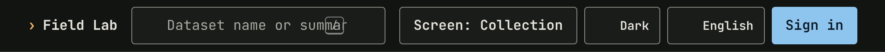
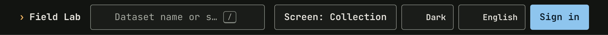
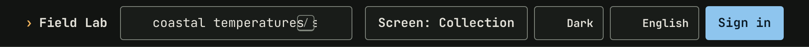
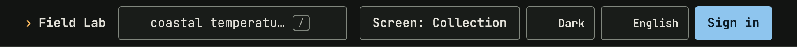
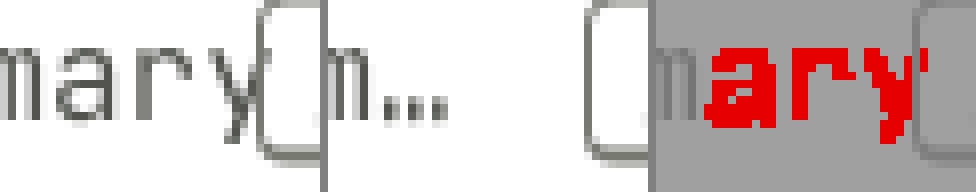

# Issue #10: search text and the "/" hint, before and after at 1024px

Header crops of the neutral example at 1024 CSS px, device scale factor 2, Chromium.

- **Before:** integrated `dev` `445bd063cb0dbaa5b73591ac91649a969e7beeeb`.
- **After:** source `0cb4a5fd69ba114c1ec20d0dc846c1e02f6b5013` (kit `97f2b29`), [PR #11](https://github.com/WakoLab-DesignSystems/wakolab-design-systems-console/pull/11).

## Placeholder (empty field)

| | Light | Dark |
| --- | --- | --- |
| Before |  |  |
| After |  |  |

## Long query (field unfocused)

| | Light | Dark |
| --- | --- | --- |
| Before |  |  |
| After |  |  |

## Parity crop, Collection, light, 360px

Frontend `e492bec` | candidate | difference (enlarged). The frontend's "…mary" runs under the hint; the candidate ends at "m…" before it. This is the deliberate difference that [Orc's decision 6976557106](https://github.com/WakoLab-DesignSystems/wakolab-design-systems-console/pull/11#issuecomment-6976557106) accepts and that `docs/PARITY.md` records as Run 4.

